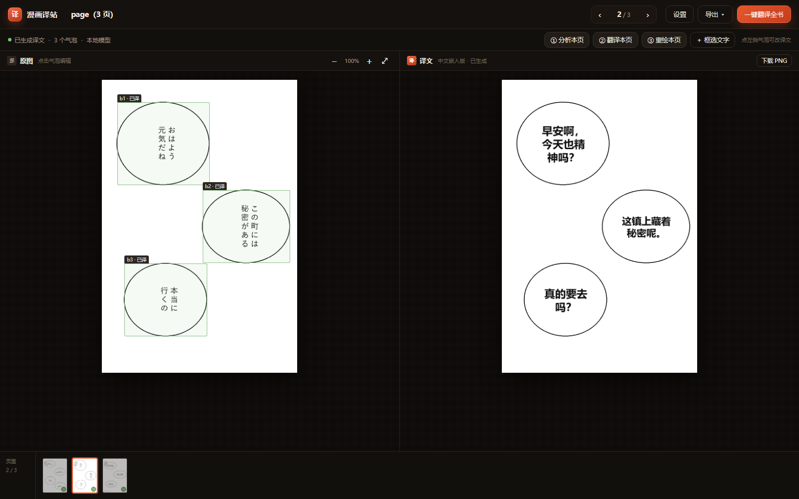

> [!WARNING]
> **此项目由 DeepSeek Harness 生成，任何人如需使用，需先全部审阅代码后使用。使用本项目则默认使用者已完全审阅且知晓该项目运行机制和风险，且同意由本项目带来的一切风险与可能带来的损失由使用者自行承担**
>
> 完整免责声明见 [DISCLAIMER.md](DISCLAIMER.md)。

# 漫画译站 · Manga Translator

把 PDF / 一组 PNG 漫画页里的台词翻译成中文，再按原位置嵌回画面的本地工具。
左边原图、右边译文，点一下气泡就能改字重绘；多张图片会自动排成一册翻页。
界面运行在程序自己的 **WinForms + WebView2 原生窗口**里，不需要外部浏览器，也没有地址栏。

**默认完全本地运行：不联网、不需要任何 API Key、不消耗 Token。**
OCR（RapidOCR + manga-ocr）、翻译（Qwen3-4B）、嵌字渲染全部在这台电脑上完成。

> 界面截图（合成测试页，非真实漫画素材）：
>
> 

---

## 目录

- [一分钟上手](#一分钟上手)
- [下载与安装](#下载与安装)
- [功能](#功能)
- [零 Token 是怎么做到的](#零-token-是怎么做到的)
- [翻译质量与连贯性](#翻译质量与连贯性)
- [使用说明](#使用说明)
- [性能](#性能)
- [技术架构](#技术架构)
- [目录结构](#目录结构)
- [仓库包含 / 不包含](#仓库包含--不包含)
- [发布到 GitHub](#发布到-github)
- [在新电脑上安装](#在新电脑上安装)
- [故障排查](#故障排查)
- [关于 API / Token 的备选方案](#关于-api--token-的备选方案)
- [隐私与版权](#隐私与版权)

---

## 一分钟上手

普通用户不需要克隆源码：

1. 打开 GitHub 的 **Releases**，下载 `MangaTranslator-1.0.0-win-x64.zip`。
2. 解压到普通文件夹（必须保留 `native\`、`scripts\`）。
3. 双击 **`scripts\setup.bat`**。它会安装 Python 依赖，并下载 llama.cpp、Qwen3-4B、manga-ocr、RapidOCR；首次约 3 GB。
4. 双击根目录 **`MangaTranslator.exe`**，在程序自己的原生窗口里使用。

详细步骤（含源码运行、更新、卸载、故障排查）见 **[INSTALL.md](INSTALL.md)**。

如果你是从源码运行：

1. 克隆或下载本仓库后，先双击 **`scripts\setup.bat`**（或运行 `scripts\setup.ps1`）。
2. 双击仓库根目录的 **`MangaTranslator.exe`**。
   它会在自己的 **WinForms + WebView2 原生窗口**里打开界面：没有地址栏、没有外部浏览器、没有需要复制粘贴的网址。
3. 窗口里先显示启动动画；本地服务就绪后自动进入首页。首次约 10–20 秒，之后窗口一直在。
4. 把 **PDF、单张图片，或一整组图片** 拖进首页的虚线框。多张图片会按文件名里的数字自然排序（01、02、10）。
5. 程序会自动处理第一页：识别气泡 → OCR → 翻译 → 嵌字。大约 15–40 秒（首次加载模型会久一点）。
6. 点左侧任意气泡，在右侧抽屉里改原文 / 译文，点「应用并重绘」。
7. 点右上角「一键翻译全书」处理整本；底部胶片条可翻页；完成后可导出译文 PDF 或双语对照 PDF。

关闭原生窗口时，会自动停掉 Python 服务和 llama.cpp；下次双击重新启动即可。

> `start.bat` 只用于开发排查（控制台 + 默认浏览器）；日常使用请双击 `MangaTranslator.exe`。

---

## 下载与安装

**Release 里发什么：** 一个 `MangaTranslator-1.0.0-win-x64.zip` 便携包。

- **不是**只发 `setup.bat`。`setup.bat` 是压缩包里的安装脚本，单独发没有意义。
- ZIP 里含原生窗口、Python 服务代码、`setup.bat`、安装教程、免责声明。
- 模型（约 2.8 GB）和 llama.cpp 不进 ZIP，由 `setup.bat` 从官方镜像下载；这样不会超过 GitHub Release 的 2 GB 单文件限制。

安装步骤：

1. Releases → 下载 ZIP；
2. 解压，保留 `native\` 和 `scripts\`；
3. 双击 `scripts\setup.bat`；
4. 双击 `MangaTranslator.exe`。

维护者打包与发布流程见 **[RELEASE.md](RELEASE.md)**。

---

## 功能

- **PDF / 多张图片**：PDF 按 200 DPI 拆页；PNG、JPG、WEBP、BMP、GIF、TIFF 可一次多选，按文件名自然排序成一册。
- **双栏对照**：左原图、右译文，同页同步切换；底部胶片条显示每页状态。
- **气泡级编辑**：点左侧气泡编辑原文/译文、说话人、横排/竖排、字号、颜色、描边；可跳过某条（保留原图文字）。
- **手动补框**：OCR 漏掉的气泡或拟声词，用「＋ 框选文字」在图上拖一个框，补原文和译文。
- **上下文翻译**：按漫画阅读顺序（日漫从右到左）组织台词，带上作品设定、人物语气、术语表、上一页结尾和下一页开头。
- **OCR 校对**：翻译前先让模型修正明显的识别错误（重复字、漏字、串列），再翻译修正后的台词。
- **术语表**：人名、地名、专有名词固定译法，全书一致。
- **嵌字**：擦除原文（白底气泡按气泡底色填充，画面上的文字用 inpaint），自动选择横排/竖排、自动换行与字号，居中排版。
- **拟声词保护**：大字号手写拟声词默认标为「音效」并跳过，不会被生硬的宋体字覆盖；需要翻译时可取消跳过。
- **导出**：当前页 PNG；全书译文 PDF；左右并排的双语 PDF。
- **项目持久化**：所有原图、OCR、译文、术语表都存在 `data/projects/<id>/`，关掉程序再开还在。

---

## 零 Token 是怎么做到的

| 环节 | 使用的本地模型 / 库 | 大小 | 说明 |
|---|---|---|---|
| 气泡检测 | OpenCV 白色连通域 + 形态学 | — | 找出封闭的白色对话气泡 |
| 文字检测 | RapidOCR（PP-OCRv6 det） | ~30 MB | 找出每一列/每一行文字框 |
| 文字识别 | **manga-ocr**（ViT+BERT） | ~450 MB | 专门在漫画字体上训练，竖排、手写、彩色字比通用 OCR 稳 |
| 翻译 | **Qwen3-4B-Instruct-2507**（Q4_K_M, GGUF） | ~2.4 GB | 通过 llama.cpp Vulkan 在本地显卡推理；4 GB 显存可跑 |
| 嵌字 | Pillow + 微软雅黑 | — | 笔画清晰、自动适配气泡 |

这些模型都已经放在项目里了（`models/`、`vendor/llama/`、`.pylibs/`）。程序运行时**不访问网络**。

---

## 翻译质量与连贯性

翻译不是逐句丢给机器，而是按「页」组织上下文：

1. **竖排专项**：日漫按「从上到下、从右到左」排序气泡；相邻文字列的检测框重叠时会在列边界去重，避免把同一个「い」读两遍；竖排文字会被还原成列序。
2. **OCR 校对**：正式翻译前，先让本地模型做一遍「只修 OCR 错字、不改剧情」的校对（设置里可关）。修正结果会显示在气泡抽屉的「模型校正」里。
3. **上下文窗口**：每批台词会带上作品名、人物设定、前情提要、术语表、上一页最后 4 句、本页前后文、下一页开头 3 句。
4. **术语表**：`术语表` 里的译名会强制注入提示词，全书保持一致；内置了少量漫画常用词（イカ耳→飞机耳等）。
5. **整本顺序处理**：一键全书按页顺序跑，后一页能看到前一页已经译好的内容。
6. **可修正**：模型不是神。任何一条都可以在抽屉里改，改完只重绘当前页，不影响其他页。

**已知限制（建议先看）**

- 花体/艺术字、极端手写体、被网点或速度线压住的字，OCR 仍可能错；用气泡编辑或手动补框修正。
- 振假名（汉字旁的小注音）偶尔会被识别成正文；可以在编辑框里删掉。
- 拟声词默认跳过；想翻译就取消「跳过这条」。
- 4B 模型的中文文采不如云端大模型，长句偶尔会过度精简；填好「人物与设定 / 术语表」会明显变好。
- 中文竖排使用单字堆叠，标点不会像专业排版那样旋转；对白为主时观感可接受。

---

## 使用说明

### 上传与自动处理

- 拖文件到首页，或点「选择文件」。
- 图片直接进入工作区；PDF 会在后台拆页（上限 300 页 / 150 MB）。
- 首页会自动跑第一页，让你马上看到效果。

### 页面操作

| 按钮 | 作用 |
|---|---|
| ① 分析本页 | 重新检测气泡 + OCR（已有译文会按原文匹配保留） |
| ② 翻译本页 | 翻译本页所有未跳过的台词，并自动重绘 |
| ③ 重绘本页 | 只重新擦字嵌字，不重新翻译 |
| ＋ 框选文字 | 在左图拖框，补充 OCR 漏掉的气泡/拟声词 |
| 一键翻译全书 | 从当前项目第 1 页开始，逐页分析→翻译→渲染 |
| 导出 | 当前页 PNG / 全书译文 PDF / 双语 PDF |

- `←` / `→` 翻页；`Esc` 关闭抽屉/设置。
- 缩放 `− / + / ⤢`，默认整页适应窗口。
- 标题栏可以直接改项目名。

### 设置

右上角「设置」：

- **翻译引擎**：本地模型（默认）/ Google 免费接口 / OpenAI 兼容接口。
- **OCR 原文校对**：默认开启，翻译前先纠正识别错字；关掉可以每页省几秒。
- **语言**：原作语言（日/英/韩/中/自动）、目标语言（简中/繁中/English）、字体、每批条数。
- **作品设定**：作品名、人物与关系、前情提要、额外翻译要求。
- **术语表**：左边原文、右边固定译名，可增删。
- **删除本项目**：连同图片、译文、编辑记录一起删。
- **退出程序**：关闭本地 Web 服务和 llama.cpp 进程（用 exe 无控制台启动时，用它彻底退出）。

> 作品设定和术语表是**项目级**的；语言、引擎、字体是全局默认值，新建项目时生效。

### 编辑气泡

1. 点左侧彩色框（蓝=对话框，黄=画面文字，灰虚线=音效/已跳过）。
2. 在抽屉里改「原文（OCR 可修正）」和「中文译文」。
3. 「应用并重绘」立即生效；「重译本条」只让模型重译这一条。
4. 清空译文 = 保留原图文字（不擦除）。

---

## 性能

实测机器：RTX 3050 Ti Laptop 4 GB / Windows 11 / Python 3.14。

| 阶段 | 耗时 |
|---|---|
| 首次加载 manga-ocr | ~10 秒（之后常驻内存） |
| 单页 OCR（24 行，含 manga-ocr） | ~7–17 秒（首行含模型加载） |
| 单页 OCR 校对 | ~4–8 秒 |
| 单页翻译（12 条） | ~7–15 秒（首次调用需启动 llama-server，约 10 秒） |
| 单页嵌字 | < 1 秒 |
| 20 页整本 | 约 10–18 分钟 |

- 多张图片在导入时一次性拆页，之后和 PDF 一样按页处理，页数上限 300。
- 显卡显存不足 4 GB 时，llama.cpp 会自动把部分层放 CPU，速度会下降但能跑。
- 没有 NVIDIA 显卡也能跑（llama.cpp 有 CPU 后端）；把设置里的 `llama_gpu_layers` 改成 0 即可，速度约为 1/3。
- manga-ocr 固定用 CPU（避免和翻译模型抢显存）。
- 设置里关掉「OCR 原文校对」可以省掉每页几秒，但错字会直接进入翻译。

---

## 技术架构

```
MangaTranslator.exe（27 KB 启动器）
   └─ native\MangaTranslator.exe（WinForms + WebView2 原生窗口）
        ├─ 窗口内嵌 WebView2，加载本地 UI（无地址栏、无外部浏览器）
        └─ 启动 start.bat → Python FastAPI 服务
             ├─ store.py       项目/页面 JSON 持久化
             ├─ pdf.py         PDF 拆页、PNG 读入、PDF 导出
             ├─ ocr.py         气泡检测 + PP-OCR 文字检测 + manga-ocr 识别 + 竖排/阅读顺序
             ├─ translate.py   OCR 校对 + 上下文提示词 + JSON schema + 分批/补漏
             ├─ llm.py         llama.cpp 进程管理 + OpenAI 兼容调用
             ├─ render.py      擦字（填充/inpaint）+ 横竖排自适应嵌字
             └─ jobs.py        全书后台任务与进度
```

- 前端仍是 HTML/CSS/JS，但运行在程序自己的 WebView2 窗口里，不是外部浏览器标签页。
- 关闭原生窗口会调用 `/api/shutdown`，停掉 Python 和 llama.cpp。

- 翻译请求用 JSON Schema 约束输出，强制 `{id, zh}` 一一对应。
- 翻译前有一道 OCR 校对（独立 JSON schema），只修识别错误；校对结果存为 `source_fixed`，不改动原始 OCR。
- 缺 id / 空译文会二次补译，再不行逐条重试。
- llama.cpp 以 `-np 1` 单槽运行，避免 4 GB 显存下 KV cache 被切碎。
- 页面数据是纯 JSON（`pages/0000.json`），可以手改、备份、版本管理。

---

## 目录结构

```
manga-translator/
├─ MangaTranslator.exe      双击启动（27 KB 启动器，调用 native 里的原生程序）
├─ native/
│  ├─ MangaTranslator.exe   WinForms + WebView2 原生窗口（仓库已附带）
│  ├─ *.dll                 .NET 运行时与 WebView2 SDK
│  └─ ...                   自包含运行时，不需要单独装 .NET
├─ desktop/                 原生窗口源码（Program.cs / csproj）
├─ scripts/
│  ├─ setup.ps1             首次安装：Python 依赖 + llama.cpp + 模型
│  ├─ setup.bat             双击入口
│  └─ build-native.ps1      重新构建 native 窗口（需要 .NET 10 SDK）
├─ start.bat                仅用于开发排查（控制台 + 浏览器）
├─ start-hidden.vbs         无控制台启动同一个原生程序
├─ app.py                   FastAPI 后端 + 本地模型/OCR 调度
├─ launcher.cs              根目录 27 KB 启动器的源码
├─ app.ico                  图标
├─ requirements.txt
├─ mt/                      后端模块
├─ static/                  前端（index.html / app.js / style.css）
├─ models/                  setup 下载（不会提交到 git）
│  ├─ Qwen3-4B-Instruct-2507-Q4_K_M.gguf
│  └─ manga-ocr-base/
├─ vendor/llama/            setup 下载（llama-server.exe）
├─ .pylibs/                 setup 安装（Python 依赖）
├─ .venv/                   setup 创建
├─ data/                    运行时生成，已被 .gitignore 忽略
│  ├─ projects/<id>/        project.json + pages/*.png + *.json + exports/
│  ├─ settings.json
│  └─ desktop.log
├─ samples/                 合成测试页
└─ docs/                    截图
```

> 为什么不把模型提交到仓库：Qwen3 模型约 2.4 GB、manga-ocr 约 450 MB、llama.cpp 约 100 MB，
> 再加上 Python 依赖，整个运行环境约 4.5 GB。GitHub 不适合直接存这些文件，所以用
> `scripts/setup.ps1` 下载；`native/` 已附带，避免普通用户安装 .NET SDK。
>
> 根目录的 `MangaTranslator.exe` 不是浏览器、也不是网页快捷方式：它启动的是
> `native\MangaTranslator.exe`，窗口由程序自己创建，没有地址栏，也没有外部 Edge 界面。

---

## 仓库包含 / 不包含

**包含：**

- 全部 Python 后端、前端、原生窗口源码和构建脚本；
- 已构建好的 `native/` 原生窗口（约 120 MB，普通用户不需要装 .NET SDK）；
- 根目录 27 KB 启动器、图标、`start.bat`、`start-hidden.vbs`；
- 合成测试页（`samples/`）和界面截图（`docs/screenshot.png`）。

**不包含（由 `scripts/setup.ps1` 下载）：**

- `models/Qwen3-4B-Instruct-2507-Q4_K_M.gguf`（约 2.4 GB）；
- `models/manga-ocr-base/`（约 450 MB）；
- `vendor/llama/`（约 100 MB）；
- `.pylibs/`、`.venv/`（Python 依赖，约 1.5 GB）；
- `data/`（你上传的漫画、译文、日志；已在 `.gitignore` 中忽略）。

这样仓库克隆体积约 120 MB（含 `.git` 历史约 170 MB）；模型和依赖不会触发 GitHub 的单文件 100 MB 限制，也不会泄露用户项目数据。

---

## 发布到 GitHub

如果你使用的是我整理好的 `manga-translator-github` 目录：它已经 `git init` 并完成首次提交，
只需要在 GitHub 新建空仓库后执行：

```powershell
cd manga-translator-github
git remote add origin https://github.com/<your-name>/manga-translator.git
git push -u origin main
```

如果是从零建立仓库，完整流程是：

```powershell
git init -b main
git add .
git commit -m "Initial commit: Manga Translator"
git remote add origin https://github.com/<your-name>/manga-translator.git
git push -u origin main
```

注意事项：

- **不要** `git add -f models/`、`vendor/`、`.pylibs/`、`data/`；这些已被 `.gitignore` 排除。
- `native/` 已包含在仓库里（约 120 MB）；如果不想提交二进制，可以把 `native/` 加入 `.gitignore`，改为在 GitHub Releases 上传 `native.zip`，让用户解压到根目录。
- 首次发布前建议在另一台 Windows 上按 `scripts/setup.bat` 跑一遍，确认模型 URL、WebView2 Runtime 和显存情况。
- 仓库默认按 MIT 许可发布；第三方模型/运行库许可见下方。
- 当前提交使用了占位作者 `Manga Translator <noreply@localhost>`；想改成你自己的，先设置 `git config user.name/user.email`，再执行 `git commit --amend --reset-author`。

---

## 在新电脑上安装

### 最快方式

```powershell
cd manga-translator
.\scripts\setup.bat
```

脚本会依次：创建 `.venv` → 安装 Python 依赖 → 下载 llama.cpp → 下载 Qwen3-4B 与 manga-ocr → 检查 native 窗口。
首次约 3 GB，视网络需要几分钟。完成后双击 `MangaTranslator.exe`。

### 手动安装

要求 Python 3.11–3.14（64 位）、Windows 10/11、WebView2 Runtime（Win11 自带）。

#### 1. Python 依赖

```powershell
cd manga-translator
python -m venv .venv
.\.venv\Scripts\python.exe -m pip install -r requirements.txt
```

`start.bat` 会优先用 `.venv\Scripts\python.exe`，否则用 PATH 里的 `python`。

#### 2. llama.cpp（本地翻译运行时）

下载 Windows Vulkan 版（NVIDIA / AMD / Intel 都能用）：

```
https://github.com/ggml-org/llama.cpp/releases/download/b11836/llama-b11836-bin-win-vulkan-x64.zip
```

解压到 `vendor/llama/`，确认 `vendor/llama/llama-server.exe` 存在。

#### 3. 翻译模型

从 ModelScope 下载（国内直连）：

```
https://www.modelscope.cn/models/unsloth/Qwen3-4B-Instruct-2507-GGUF/resolve/master/Qwen3-4B-Instruct-2507-Q4_K_M.gguf
```

放到 `models/`。也可以换更小的 `Qwen2.5-3B-Instruct-Q4_K_M`，在设置里把模型文件名改成对应文件即可。

#### 4. 漫画 OCR 模型

从 HuggingFace 镜像下载以下文件到 `models/manga-ocr-base/`：

```
https://hf-mirror.com/kha-white/manga-ocr-base/resolve/main/config.json
https://hf-mirror.com/kha-white/manga-ocr-base/resolve/main/preprocessor_config.json
https://hf-mirror.com/kha-white/manga-ocr-base/resolve/main/pytorch_model.bin
https://hf-mirror.com/kha-white/manga-ocr-base/resolve/main/special_tokens_map.json
https://hf-mirror.com/kha-white/manga-ocr-base/resolve/main/tokenizer_config.json
https://hf-mirror.com/kha-white/manga-ocr-base/resolve/main/vocab.txt
```

没有这个目录时程序会自动退化为只用 RapidOCR（仍能跑，手写/彩色字效果差一些）。

#### 5. 启动

```powershell
.\MangaTranslator.exe
```

仓库已附带 `native\`（自包含 .NET + WebView2 SDK），普通用户不需要安装 .NET SDK。
只有修改 `desktop/` 源码后才需要重新构建：

```powershell
.\scripts\build-native.ps1
```

`native\` 需要 **WebView2 Runtime**（Windows 11 自带；Windows 10 若没有可安装 Microsoft Edge WebView2 Evergreen Runtime）。

---

## 故障排查

| 现象 | 处理 |
|---|---|
| 双击 `MangaTranslator.exe` 没反应 | 先用 `start.bat` 看 Python 报错；SmartScreen 拦截时右键 exe → 属性 → 解除锁定 |
| 原生窗口空白 / 一直转圈 | 看 `data/desktop.log` 和 `data/crash.log`；确认 `native\` 文件夹完整、系统有 WebView2 Runtime |
| 原生窗口提示「启动失败」 | 日志里有 Python 报错；用 `start.bat` 复现，检查 `.venv`、`.pylibs`、模型文件 |
| 双击 `start.bat` 闪退 | 在该目录打开 PowerShell 执行 `.\start.bat`，看报错；多半是 Python 或依赖路径问题 |
| 多张图片顺序不对 | 文件名里带数字（01、02、10）即可自然排序；也可以先改名再拖入 |
| 「本地模型未启动」 | 设置里点「启动模型」；或看 `data/llama-server.log` 最后 40 行 |
| 翻译时报「模型正在启动中」 | 首次加载需 10–20 秒，等状态变绿再点 |
| 显存不足 / 很慢 | 设置里把 `llama_gpu_layers` 调低（如 20）或 0；关闭其他占显存的程序 |
| 第一页处理很久 | manga-ocr 首次加载 ~10 秒 + llama-server 首次启动 ~10 秒，属正常 |
| OCR 漏字/错字 | 点气泡改原文；或用「＋ 框选文字」补一个框；确认设置里「OCR 原文校对」是开着的 |
| 拟声词没翻译 | 默认跳过以保留原图笔触；点开该气泡取消「跳过这条」，再「重译本条」 |
| PDF 导出提示有页未生成 | 先「一键翻译全书」，等所有页状态变绿 |
| 想换端口 | 设置环境变量 `MT_PORT=9000` 再启动 |
| 中文显示成方块 | 确认 Windows 有微软雅黑（`C:\Windows\Fonts\msyh.ttc`）；设置里换「黑体」 |
| 删除项目失败 | 关闭正在进行的任务后再删；或手动删 `data/projects/<id>` |

日志：

- 原生窗口 / Python 启动：`data/desktop.log`
- 原生窗口崩溃：`data/crash.log`
- 本地模型：`data/llama-server.log`

---

## 关于 API / Token 的备选方案

你明确说过不想消耗自己的 Token，所以**默认路径完全不使用 API**。下面只是把取舍讲清楚，方便你以后需要时切换。

### 方案 A：本地模型（当前默认）

- **费用**：0 Token，0 元。
- **隐私**：图片和文字不离开电脑。
- **优势**：离线、无限量、可反复重译。
- **劣势**：首次要下载 ~3 GB 模型；4B 模型文采和长上下文能力弱于云端大模型；占 CPU/GPU。

### 方案 B：Google 免费接口（无需 Key）

- **费用**：0 Token，但依赖 Google 的网络可达性。
- **优势**：无需下载模型，速度快。
- **劣势**：逐句翻译，**没有上下文和术语表**，人名/语气容易前后不一致；国内网络通常不可用；接口可能随时变更。
- 在设置里选「Google 免费接口」即可。程序里已实现，但当前网络下不可用。

### 方案 C：OpenAI 兼容接口（需要你自己的 Key）

- **费用**：按服务商计价。粗略估算：一页漫画 10–20 条台词，约 800–1500 输入 token + 300–500 输出 token；20 页约 2–3 万 token。具体价格以服务商为准（DeepSeek、OpenAI、通义等都可以，只要是 OpenAI 兼容 `/v1/chat/completions`）。
- **优势**：质量最好，长上下文连贯性最好，速度快。
- **劣势**：要花钱、要联网、台词会发送给服务商；需要自己保管 Key。
- 设置里选「OpenAI 兼容接口」，填 Base URL、模型名、Key 即可。**不填 Key 就不会走这条路。**

> 结论：日常使用建议保持「本地模型」。如果某一页特别重要，再临时切换到云端精翻，或直接在抽屉里手动润色。

---

## 隐私与版权

- 所有项目文件都在本机 `data/projects/`，没有上传逻辑；本地模型也不联网。
- 只有你主动选择 Google / OpenAI 兼容引擎时，才会把**当前页的台词文本**发出去（不是整张图）。
- 请只翻译你拥有版权或获得授权的内容。本项目不附带任何漫画素材；`samples/` 里是程序生成的合成测试页。

---

## 许可

- 本项目代码：MIT。
- Qwen3-4B：Apache-2.0。
- manga-ocr：MIT（模型权重以其仓库声明为准）。
- llama.cpp：MIT。
- RapidOCR / PP-OCR：Apache-2.0。
